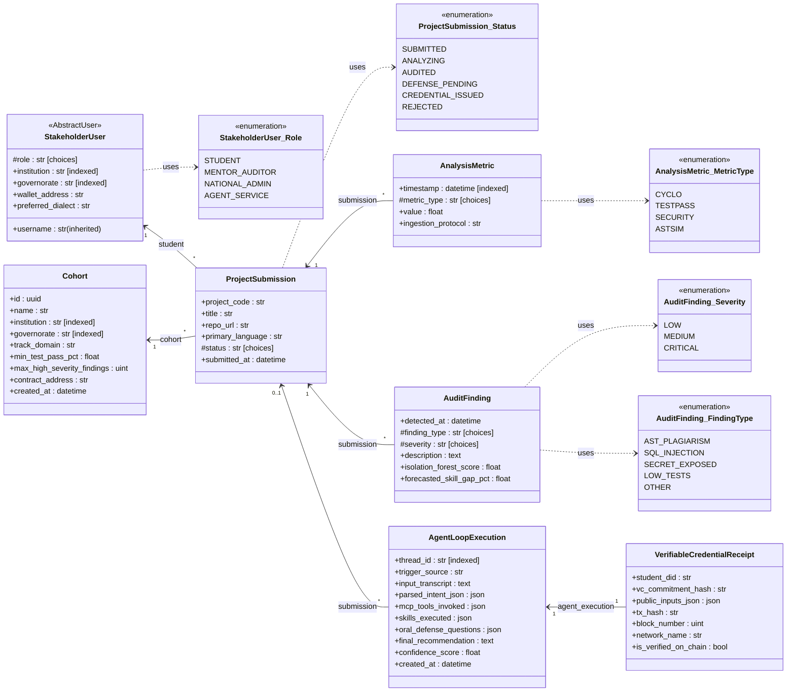
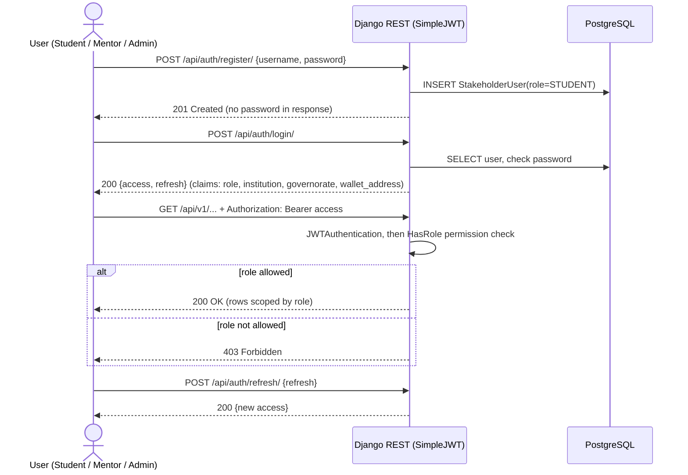
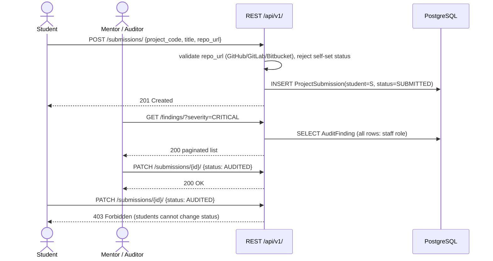
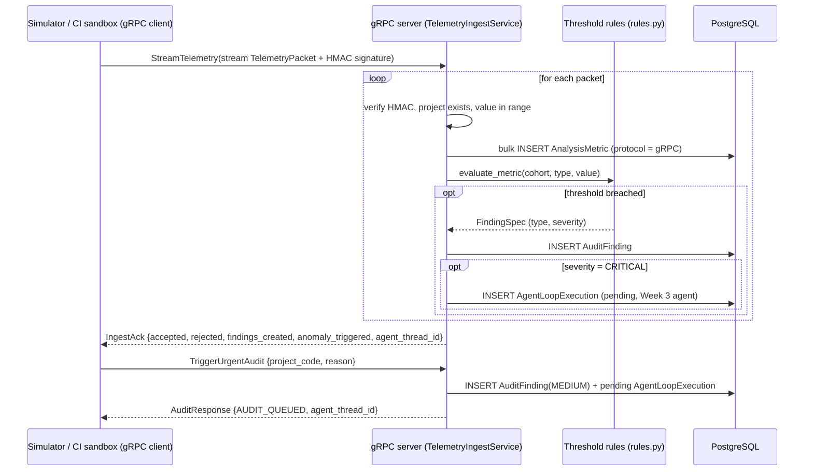
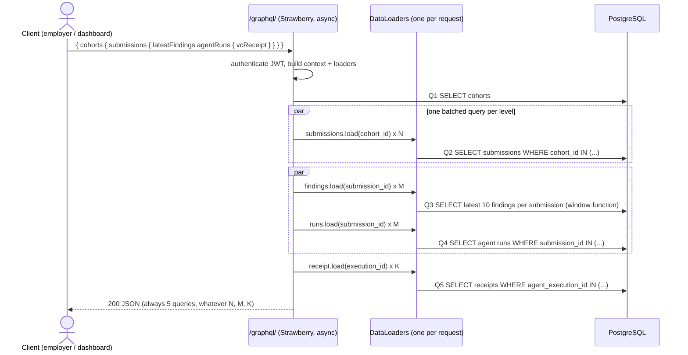

# UML diagrams - TuniSkill-DID (Track 6) - Week 1

Open in GitHub, VS Code (Markdown Preview Mermaid Support) or paste each block into https://mermaid.live to export PNG/SVG for the slides.

## UML Class Diagram (generated from `models.py`)

> Generated by `docs/generate_uml.py` - do not edit by hand; re-run after any model change.

## UML Sequence Diagrams

### 1. JWT authentication and role-based access (RBAC)

### 2. Student submits a project, mentor reviews it (REST)

### 3. Telemetry ingestion over gRPC and anomaly detection

### 4. GraphQL nested query with DataLoader batching (no N+1)

